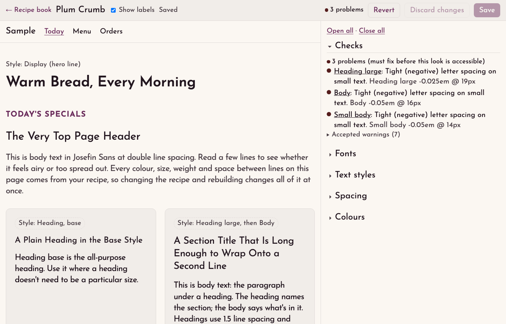
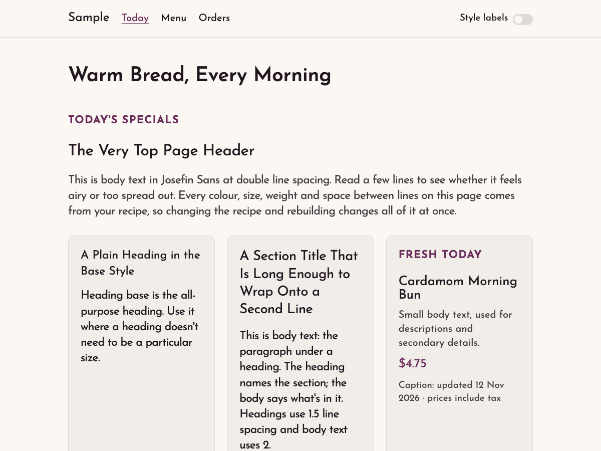

# Fournée looks

A recipe book and a labeled look editor for [Fournée](https://github.com/fournee/fournee), the colour + type by role
theming toolkit. Each **look** is a Fournée recipe (colour and type) plus spacing, previewed live on a sample page that
shows every text style and colour role.

Built with Fournée: this project doesn't change Fournée, it reads it from a clone beside this folder (`../fournee`).





## What's here

- **Recipe book** (http://127.0.0.1:4747/): every look as a card with its preview, fonts and colours.
  New, New from this, Rename, Delete (moves the look to `looks/_deleted/`).
- **Look editor**: the sample page on the left updates as you change things on the right:
  - **Checks**: Fournée's accessibility pass, in plain words. Problems (round dot) should be fixed; warnings (diamond)
    can be **Accept**ed if they're on purpose. Click one to jump to the control that causes it.
  - **Fonts**: the three font slots. **Text styles**: font, weight, size, line spacing, letter spacing, ALL CAPS and
    italic for each style. **Spacing**: white space on the page. **Colours**: picker, hex and live contrast.
  - Each section folds open and shut (remembered); **Open all / Close all** at the top.
  - **Save** writes the look and rebuilds it, keeping the previous version. **Revert** swaps back to it.
- **Sample page**: one page that uses every role. A **Style labels** switch shows or hides the "Style:" notes.

Plum Crumb uses tight (negative) letter spacing on purpose, so its Checks show 3 problems. That's a taste choice for
this look, not something Fournée recommends.

## Run it

Needs Node.js 20+ and a clone of Fournée next to this folder:

```sh
git clone https://github.com/fournee/fournee.git
git clone https://github.com/kfavkrs/fournee-looks.git
```

On a Mac, double-click **Open Look Editor.command** (it opens Chrome at http://127.0.0.1:4747/; keep the Terminal window
open while you work). Or run `node tools/editor/server.mjs` and open that address. It listens on this computer only.

**Update Fournee and Rebuild Looks.command** gets the latest Fournée, rebuilds and checks every look, then asks before
saving the changes to GitHub.

## Files

- `looks/<name>/`: one folder per look.
  - `recipe.json` the look (a Fournée recipe), `spacing.json` its spacing, `accepted.json` its accepted warnings,
    `*.prev.json` the version before the last save.
  - `src/`: built by `tools/build-look.mjs`; don't edit by hand. `src/theme/` is Fournée's output;
    `src/spacing.css` is this project's addition; `src/look.css` holds hand-written
    extras for one look (colour roles only, no hex).
- `index.html`: the sample page, shared by every look. Add `?clean` to its address to hide the labels.
- `tools/build-look.mjs <name>`: builds one look. `tools/check.mjs <name>`: Fournée's checks in Terminal.
- `tools/editor/`: the recipe book and editor (a small Node server, no dependencies).
- `type/build-type.mjs`: Fournée's suggested build script for a single-look project, kept for reference.

## Fournée gaps this works around

- Spacing isn't part of Fournée, so it lives in `spacing.json` here.

Some looks are kept private and aren't in this repo.

## License

MIT, like Fournée. Fonts embedded in the recipes keep their own licenses (Josefin Sans and JetBrains Mono: SIL Open Font License).
